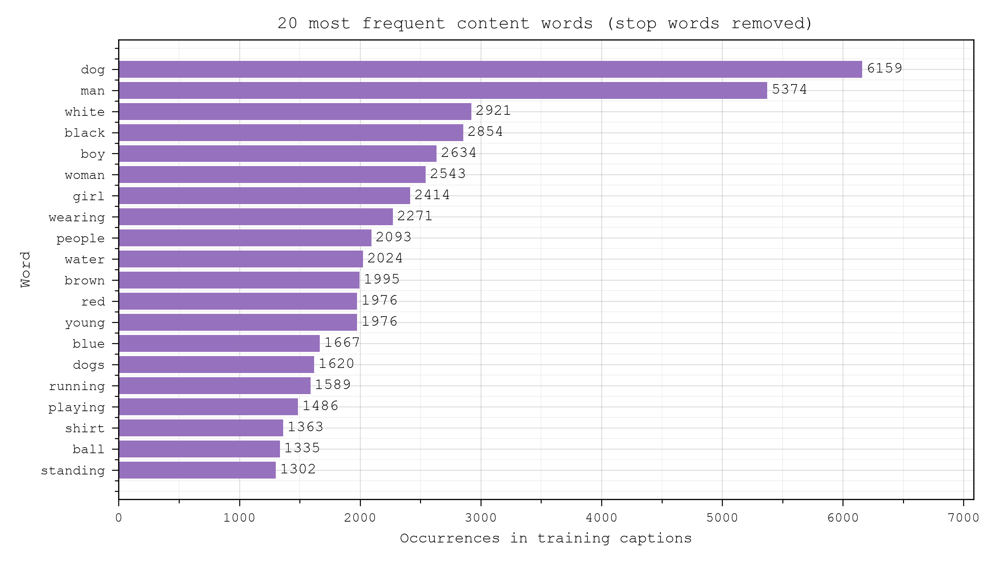
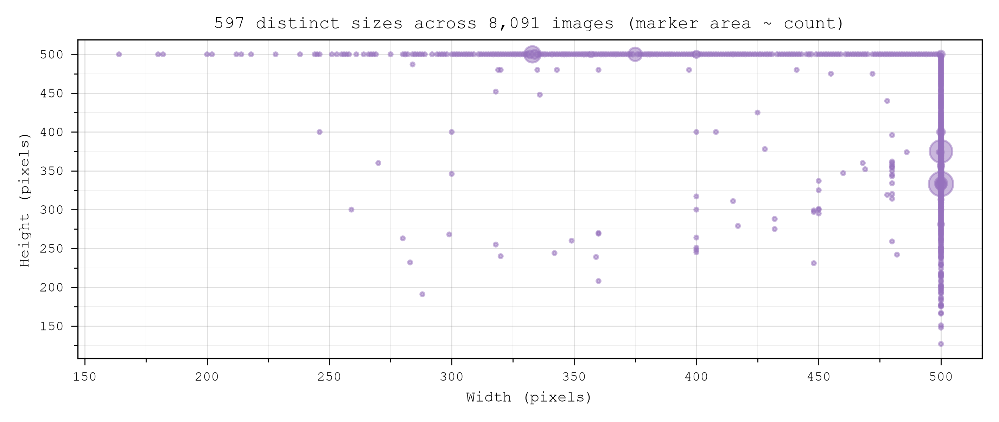

# Assignment 3 - M1 Dataset Proposal
## 1. Group and proposed task
- **Group name:** Placeholder
*Table 1. Group members*

| Full name | Student ID |
| ---------------- | ---------- |
| Vu Duc Viet Anh | 2352074 |
| Tran Lam Anh | 2352067 |
| Le Nguyen Khang | 2352470 |
| Tran Nguyen Giap | 2352284 |

- **Task track:** Multimodal learning, image-text retrieval.
- **Problem statement:** Rank captions for an image and rank images for a caption.
- **Prediction unit:** One query, either an image or a caption.
- **Input:** The query and the candidates from the other modality.
- **Output / labels:** A ranked list. Each image has five matching captions, and each caption has one source image in the official evaluation.
- **Dataset fit:** Flickr8k provides five human-written captions per image and official splits for both retrieval directions.

## 2. Dataset identity and access

- **Dataset name:** Flickr8k.
- **Source and download URL:** Original dataset information: https://hockenmaier.cs.illinois.edu/Framing_Image_Description/KCCA.html. Download mirror: https://github.com/jbrownlee/Datasets/releases/tag/Flickr8k.
- **Version / release / access date:** Downloaded from the mirror release tagged `Flickr8k`, published on 20 February 2019. Download date: 10 November 2026.
- **License and permitted use:** The original authors provide access for non-commercial research and educational use. Image use must respect Flickr's terms of use.
- **Data format and storage size:** JPEG images and plain-text caption and split files. Each caption record contains an image filename, a caption ID from 0 to 4, and the caption text. The downloaded archives contain 1,115,419,746 bytes of image data and 2,340,801 bytes of text data in compressed form. The extracted dataset contains 1,114,733,885 bytes of RGB JPEGs (about 1,063.09 MiB) and 10,113,299 bytes of tab-separated text (about 9.64 MiB). The text files contain captions, split lists, and human judgments.
- **Collection and annotation process, if known:** Images were collected from Flickr and paired with five human-written English captions per image. Captions describe the visible objects, actions, and scenes. Image filenames link each image to its captions.
- **Known limitations or biases:** The dataset focuses on people and animals performing everyday actions, which limits its coverage of other visual domains. Captions are in English and differ in wording and the details they describe. The standard split contains only 8,000 images. Our downloaded files contain 8,091 JPEG images but captions for 8,092 image IDs; all 8,000 images in the supplied train, validation, and test lists have corresponding image files and captions.

## 3. Dataset size and preliminary analysis

*Table 2. Dataset size and input statistics*

| Measure | Result |
| --- | --- |
| Full release | 8,091 images and 40,455 matched English captions |
| Official splits | 8,000 images and 40,000 image-caption pairs (Table 4) |
| Exclusions | 91 images outside the official splits and five lines with the malformed key `2258277193_586949ec62.jpg.1` |
| Image dimensions | Width 164–500 px (median 500), height 127–500 px (median 375). There are 597 distinct sizes. Forty-eight images have a short side below 224 px. |
| Caption length | Training range 2–36 tokens (median 10). Mean lengths are 10.79 in training, 10.90 in validation, and 10.84 in test. |
| Vocabulary | 7,692 training words, including 3,188 that occur once. The most frequent content words are "dog" (6,159) and "man" (5,374). |
| Tokens absent from training | 1.34% in validation and 1.22% in test |

The official splits contain 40,000 aligned image–text pairs, including 30,000 for training. Instructor approval is pending.

*Table 3. Image and caption quality*

| Check | Result |
| --- | --- |
| File integrity | Every image decoded and had five matching captions after the malformed lines were removed. |
| Duplicates | One of 6,701 candidate pairs matched pixel for pixel. Both copies are in training and are retained. |
| Captions of at most three tokens | 141 in training, 19 in validation, and 28 in test. All are retained. |
| Caption text shared by multiple images | 142 distinct texts in training, five in validation, and seven across 13 test images after tokenization. |
| CrowdFlower judgments | A majority accepted 700 of 721 original pairs (97.1%) and 2,004 of 47,109 pairs with a caption from another image. |
| Expert judgments | The mean rating rounded to 4 for 155 of 158 original pairs and to 3 for the other three. All three experts gave 4/4 to 103 of 5,664 pairs with a caption from another image. |

The human judgments cover test pairs and are used only for error analysis. See the [EDA results](../results/a3/eda/flickr8k/summary.json) and Appendix A.

## 4. Split and leakage prevention

- **Official or custom train / validation / test split:** We use the official split files `Flickr_8k.trainImages.txt`, `Flickr_8k.devImages.txt` and `Flickr_8k.testImages.txt`, with the dev split as validation. No image is listed in more than one file, and no file lists an image twice. `summary.json` records the SHA-256 digest of each file, so a new download can be checked against the files we used.
- **Expected sample counts per split:**

*Table 4. Images and caption pairs by split*

| Split | Images | Image-caption pairs | Source file |
| --- | ---: | ---: | --- |
| train | 6,000 | 30,000 | `Flickr_8k.trainImages.txt` |
| validation | 1,000 | 5,000 | `Flickr_8k.devImages.txt` |
| test | 1,000 | 5,000 | `Flickr_8k.testImages.txt` |
| total | 8,000 | 40,000 | usable samples of section 3 |

- **Split unit (for example, subject, scene, document, or source video):** One image together with all five of its captions. The official files list images, and every caption follows its image into that image's split.
- **Why this unit prevents leakage:** No test image, and therefore no test image-caption pair, is seen during training or model selection, because an image and its captions are never in different splits. Two weaker forms of overlap remain.
  - **Identical caption text:** 62 of the 5,000 test captions (for 58 images) and 43 of the 5,000 dev captions (for 40 images) are identical, after tokenization, to a training caption. An example is "two dogs playing in the snow". These captions describe different images, so no pair leaks, but the model has seen their exact wording. We keep them so that the test set matches the published one, and we will note them as a limitation.
  - **Related photographs:** different photographs of the same event cannot be grouped, as explained in the duplicate check below.
- **Stratification or grouping policy:** We keep the official image-level split. The release has no photographer or event IDs for grouping related images.
- **Random seed and reproducible split procedure:** Use the official split files and record their SHA-256 digests. Use seed 42 for training.
- **Duplicate / near-duplicate checks across splits:** A difference hash (dHash) of each image finds candidate pairs within 12 of 64 bits, and a candidate is confirmed when the mean absolute RGB difference at 64x64 pixels is below 5.0 on the 0 to 255 scale. These are the thresholds of our Assignment 2 audit. Of 6,701 candidates, one pair is confirmed, and both images are in the training split, so no duplicate crosses splits. The check detects copies of the same photograph, not different photographs of the same event. The release provides no photographer or event identifiers, so such related images cannot be grouped and may appear in different splits.
- **Test-set isolation plan:** The test split is used only for the final evaluation.
  - **Selection on dev:** models, hyperparameters and checkpoints are chosen on the dev split, and the test split is evaluated once, after all configurations are fixed.
  - **No test data in training:** test images and captions are never used for training, for building a vocabulary, or for computing any statistic used in preprocessing.
  - **Candidate pools:** Rank 5,000 test captions for each of 1,000 image queries and 1,000 test images for each of 5,000 caption queries. Apply the same protocol within validation.
  - **Human judgements:** they cover only test images, so they are used only to analyse results, never for training or model selection.
- **Subset selection rules, if any:** We use every image in the official splits and all five of its captions. We exclude only the 91 images that are in no split file and the five captions whose key `2258277193_586949ec62.jpg.1` names no image. We keep the very short captions, the 21 own pairs without a CrowdFlower majority yes, and the duplicate pair in the training split (section 3).

## 5. Evaluation plan

- **Primary metrics:** Report Recall@1, @5, and @10 in both directions. A query counts as a hit if any official match appears in the top K.
- **Secondary analysis:** Break down caption-to-image recall by query length.
- **Qualitative examples:** Show the query, its official matches, and the top-ranked results for a fixed sample of hits and misses.
- **Error analysis:** Check whether misses confuse objects or actions, and flag plausible matches that the official labels do not credit. Use the human judgments where available.
- **Decision criterion:** Select checkpoints by the mean validation Recall@1 across both directions. Report all six recall scores on test once the configurations are fixed.

## 6. Model and experiment plan

- **Simple baseline:** Rank candidates at random to establish a chance baseline for each direction.
- **Planned model:** Use Torchvision ResNet-50 (`ResNet50_Weights.IMAGENET1K_V2`) for images and an LSTM encoder for captions. Project both into a shared space and rank candidates by cosine similarity.
- **Fine-tuning:** Freeze ResNet-50 initially. Train the text encoder and both projections with a bidirectional contrastive loss. Treat captions of the same image as positives. Then fine-tune the final ResNet block at a lower learning rate.
- **Controlled experiment:**
  - **Hypothesis:** Fine-tuning the final ResNet block improves retrieval.
  - **Changed factor:** Keep the final block frozen or fine-tune it from the same checkpoint.
  - **Fixed factors:** Keep the data, model, batch construction, training budget, and seed fixed.
  - **Decision criterion:** Compare both runs using the checkpoint and test protocol in Section 5.

## 7. Compute and reproducibility estimate

- **Hardware:** Record the GPU model, VRAM, and system RAM before training.
- **Runtime:** Use a pilot to estimate training time per epoch. Time image encoding, text encoding, and ranking separately.
- **Storage:** Budget about 2.1 GiB for the archives and extracted dataset. Measure feature caches, checkpoints, and logs during the pilot.
- **Software:** Record and lock the Python, PyTorch, and torchvision versions before training.
- **Seed and checkpoint:** Use seed 42 and the validation rule in Section 5.
- **Fallback:** Cache image features for the frozen run. If memory limits require smaller batches, use the same batch size and negative sampling procedure for the compared runs.

## 8. Approval record

- **Submission date and location:** Not yet submitted. Planned submission: 18 November 2026, through the course-designated channel.
- **Instructor decision:** Pending.
- **Decision date:** Pending.
- **Conditions or requested changes:** Pending instructor feedback.
- **Changes made in response:** Not applicable yet.

---
## Appendix A. EDA evidence

All numbers and figures come from one run of `scripts/eda/run_flickr8k.py` and are stored in `results/a3/eda/flickr8k/`.

*Table 5. Flickr8k data quality checks*

| Check | Result | Method |
| --- | ---: | --- |
| Images that fail to decode | 0 | Full decode of every image |
| Images without captions | 0 | Caption keys matched to filenames |
| Captions without an image | 0 | Same matching |
| Captions with a malformed key | 5 | Key does not end in `.jpg` |
| Images in no split file | 91 | Split files matched to filenames |
| Images listed in two split files | 0 | Pairwise overlap of split files |
| Confirmed duplicate image pairs | 1 (within train) | dHash candidates, then pixel check |
| Test captions shared by several images | 7 (13 images) | Identical text after tokenization |
| Own test pairs without a CrowdFlower majority yes | 21 of 721 | `CrowdFlowerAnnotations.txt` |

*Figure 1. The first four test images and their reference captions.*

*Figure 2. Caption length by split.*

*Figure 3. The 20 most frequent content words in training captions.*

*Figure 4. Image dimensions across Flickr8k.*

*Figure 5. The only confirmed duplicate pair. Both images are in training.*
