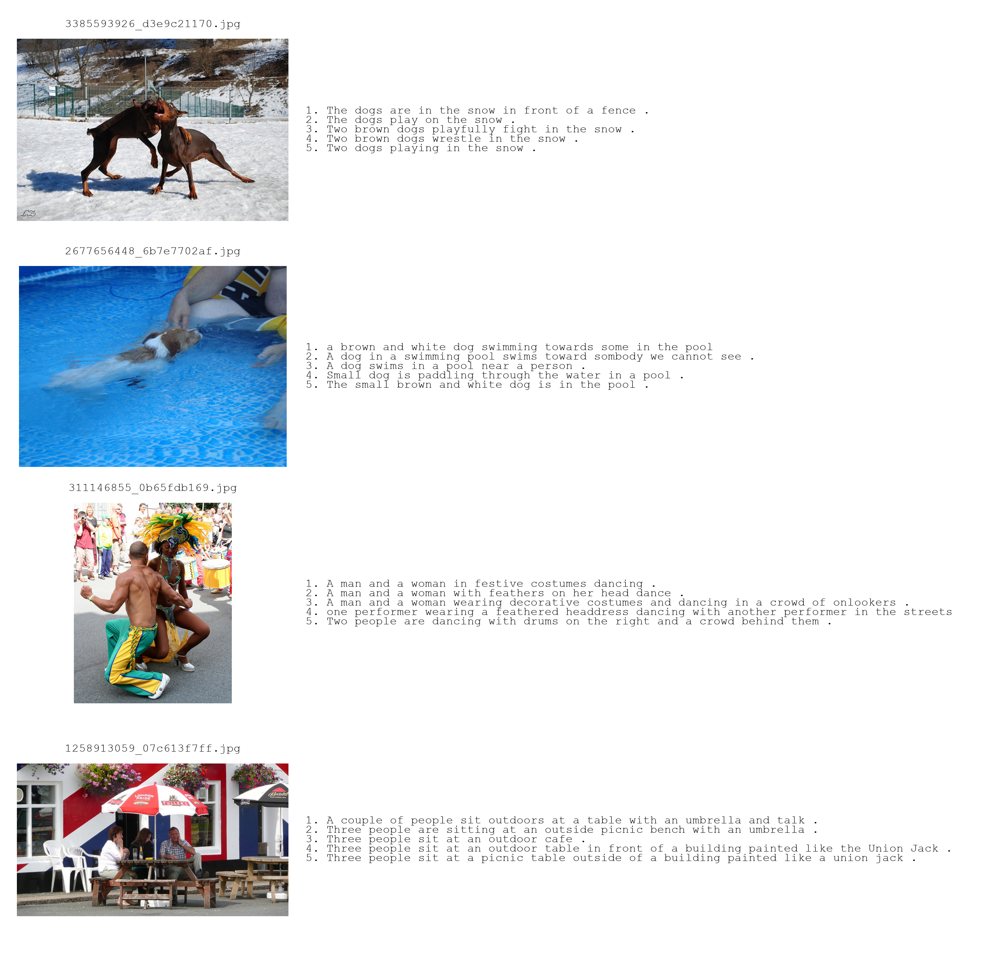
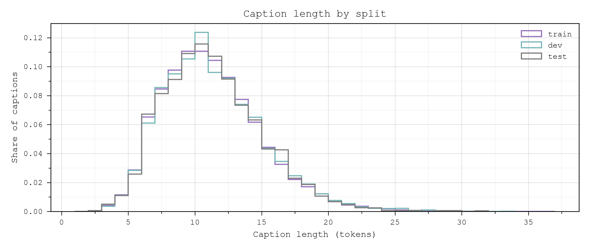
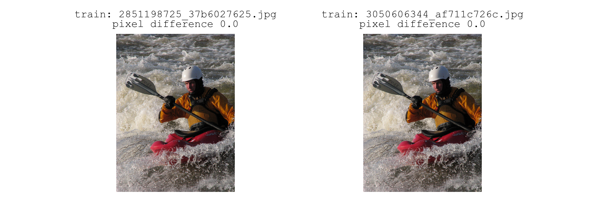

# Assignment 3 - M1 Dataset Proposal

> Complete this proposal for one task track before beginning the main Assignment 3 implementation. Submit it for instructor approval. Do not treat this template as an approved dataset proposal.

## 1. Group and proposed task

- **Group name / ID:** Placeholder
- **Members: **
  | Full name | Student ID |
  | ---------------- | ---------- |
  | Vu Duc Viet Anh | 2352074 |
  | Tran Lam Anh | 2352067 |
  | Le Nguyen Khang | 2352470 |
  | Tran Nguyen Giap | 2352284 |

- **Task track:** Multimodal learning — image captioning.
- **Problem statement:** Generate an English sentence describing the main objects, actions and scenes in an image.
- **Prediction unit:** One image.
- **Input:** An image. The model also receives the preceding reference-caption tokens to predict the next token.
- **Output / labels:** A generated English caption. Each image has five human-written reference captions for training and evaluation.
- **Why this task and dataset are suitable:** Flickr8k links images with natural-language descriptions, allowing the model to learn the relationship between visual content and text. The proposed split contains 6,000 training, 1,000 validation, and 1,000 test images.

## 2. Dataset identity and access

- **Dataset name:** Flickr8k.

- **Source and download URL:** Original dataset information: https://hockenmaier.cs.illinois.edu/Framing_Image_Description/KCCA.html. Download mirror: https://github.com/jbrownlee/Datasets/releases/tag/Flickr8k.

- **Version / release / access date:** Downloaded from the mirror release tagged `Flickr8k`, published on 20 February 2019. Download date: 10 November 2026.

- **License and permitted use:** The original authors provide access for non-commercial research and educational use. Image use must respect Flickr's terms of use. The dataset authors do not own the copyright of the images.

- **Data format and storage size:** JPEG images and plain-text caption and split files. Each caption record contains an image filename, a caption ID from 0 to 4, and the caption text. The downloaded archives contain 1,115,419,746 bytes of image data and 2,340,801 bytes of text data in compressed form. Extracted JPEG files total approximately 1,063.09 MiB, and the main text files total 9.64 MiB.

- **Collection and annotation process, if known:** Images were collected from Flickr and paired with five human-written English captions per image. Captions describe the visible objects, actions, and scenes. Image filenames link each image to its captions.

- **Known limitations or biases:** The dataset focuses on people and animals performing everyday actions, which limits its coverage of other visual domains. Captions are in English and differ in wording and the details they describe. The standard split contains only 8,000 images. Our downloaded files contain 8,091 JPEG images but captions for 8,092 image IDs; all 8,000 images in the supplied train, validation, and test lists have corresponding image files and captions.

## 3. Dataset size and preliminary analysis

- **Total samples:** The downloaded data contain 8,091 JPEG images and 40,460 captions associated with 8,092 image IDs.

- **Proposed usable samples:** We propose using the 8,000 images in the supplied splits: 6,000 for training, 1,000 for validation, and 1,000 for testing. Each image has five captions, giving 40,000 image–caption pairs.

- **Annotation types and counts:** Five human-written English captions per image. The proposed subset contains 30,000 training, 5,000 validation, and 5,000 test captions.

- **Class / target distribution:** This is a sequence-generation task without fixed class labels. Targets are English captions. Word-frequency and caption-length distributions remain to be measured using the training split.

- **Input size or length distribution:** Image width, height, aspect ratio, and caption-length distributions remain to be measured. Caption length will initially be counted as whitespace-separated words, before model tokenization.

- **Missing, invalid, duplicate, or low-quality records:** All 8,000 image IDs in the supplied splits have corresponding image files and five captions. The split lists have no overlapping image IDs. The full caption file contains 8,092 image IDs, while the image archive contains 8,091 JPEG files. Image decoding, duplicate-content detection, empty-caption checks, and pair-quality inspection remain to be completed.

- **Evidence (tables, plots, or analysis links):** Preliminary counts come from the extracted image directory, `Flickr8k.token.txt`, and the three supplied split lists. Reproducible EDA outputs and figures are pending.

- **Relevant task-specific checks:** Check image decoding, image–caption filename matching, five captions per image, empty or repeated captions, caption lengths, and duplicate or near-duplicate images across splits. Inspect sample image–caption pairs for mismatches. Keep all captions of an image in the same split.

- **How the dataset meets the handbook's threshold for this track (or justification for an exception):** Section 28.2 requires approximately 5,000 or more images for captioning and prefers multiple captions per image. Our proposed subset contains 8,000 images with five captions each, including 6,000 training images, and therefore meets the default size threshold. Instructor approval is still required.

## 4. Split and leakage prevention

- **Official or custom train / validation / test split:** Use the supplied split lists: `Flickr_8k.trainImages.txt`, `Flickr_8k.devImages.txt`, and `Flickr_8k.testImages.txt`.

- **Expected sample counts per split:** Training: 6,000 images and 30,000 captions. Validation: 1,000 images and 5,000 captions. Test: 1,000 images and 5,000 captions.

- **Split unit (for example, subject, scene, document, or source video):** Image ID. All five captions associated with an image remain in the same split.

- **Why this unit prevents leakage:** Grouping by image ID prevents the same image from appearing in multiple splits through different captions. It does not guarantee separation of related scenes or near-duplicate images, which require additional checks.

- **Stratification or grouping policy:** Preserve the supplied image-level grouping without additional stratification. Captioning has no fixed class labels to stratify by.

- **Random seed and reproducible split procedure:** No new random split is generated. Split membership comes directly from the supplied lists. Record their SHA-256 checksums to identify the exact files used. Use seed 42 for training randomness.

- **Duplicate / near-duplicate checks across splits:** No overlapping image IDs were found between the supplied splits. We will check exact duplicates using file hashes and screen for near-duplicates using perceptual hashes, followed by manual inspection. Any confirmed leakage and changes to the split will be documented before training.

- **Test-set isolation plan:** Use training data only to fit the vocabulary and any learned preprocessing. Use validation data for model selection, hyperparameter choices, and decoding settings. Keep test captions out of training and tuning, and evaluate the test set only after these choices are fixed. Initial test-data inspection is limited to integrity and leakage checks.

- **Subset selection rules, if any:** Use only the 8,000 image IDs in the supplied split lists and their five captions. Exclude records outside these lists. Any further exclusion due to corruption or confirmed duplication will be documented with the affected image IDs and updated counts.
- **Dataset name:**
- **Source and download URL:**
- **Version / release / access date:**
- **License and permitted use:**
- **Data format and storage size:** All 8,091 images are RGB JPEG files and occupy 1,114,733,885 bytes (about 1.1 GB). Captions, split lists and human judgements are tab-separated text files totalling 10,113,299 bytes (about 10 MB).
- **Collection and annotation process, if known:**
- **Known limitations or biases:**

## 3. Dataset size and preliminary analysis

- **Total samples:** The release contains 8,091 images. `Flickr8k.token.txt` yields 40,455 captions for these images, exactly five per image. Five further lines use the key `2258277193_586949ec62.jpg.1`, which names no image in the archive, so we drop them. Every image has captions and every caption names an existing image, so no modality is missing.
- **Proposed usable samples:** We use the 8,000 images listed in the official train, dev and test files, which give 40,000 image-caption pairs. The 91 images that appear in no split file are left out, so that our test set matches the published one. Every image decodes fully. The single confirmed duplicate image pair lies inside the training split and is kept, because it cannot leak into validation or test.
- **Annotation types and counts:** Each image has five independently written English captions, and `Flickr8k.lemma.token.txt` is a lemmatized copy of them. The release also contains human judgements of image-caption pairs, all on the 1,000 test images. `ExpertAnnotations.txt` scores 5,822 pairs from 1 (does not describe the image) to 4 (describes the image) by three experts. `CrowdFlowerAnnotations.txt` records yes and no votes, at least three per pair, for 47,830 pairs. We use the judgements only to assess pair quality and the evaluation protocol, never for training or model selection.
- **Class / target distribution:** Retrieval has no class labels: the target of an image is its own captions, and the target of a caption is its image. Caption vocabulary shows the content instead. In the 30,000 training captions, the most frequent content words are "dog" (6,159 occurrences) and "man" (5,374), followed by colour words and words for people (Appendix A). Scenes of dogs and people therefore dominate, and many test images will have visually and verbally similar neighbours. The training vocabulary has 7,692 words, 3,188 of which occur only once. Words absent from the training captions make up 1.34 percent of dev tokens and 1.22 percent of test tokens.
- **Input size or length distribution:** Image width ranges from 164 to 500 pixels (median 500) and height from 127 to 500 pixels (median 375), across 597 distinct sizes. Only 48 images have a short side below 224 pixels, the usual input size of pretrained image encoders. Training captions have 2 to 36 tokens, with median 10 and mean 10.79. The dev and test means are 10.90 and 10.84, and the length distributions of the three splits nearly coincide (Appendix A). A token is a lowercased word that contains at least one letter or digit.
- **Missing, invalid, duplicate, or low-quality records:** No image is missing captions, no caption is missing its image, and no image fails to decode. Apart from the five captions with a malformed key, the audit found:
  - **Duplicate images:** the perceptual-hash search returned 6,701 candidate pairs. A pixel comparison confirmed one, `2851198725_37b6027625.jpg` and `3050606344_af711c726c.jpg`, which have a hash distance of 0 and a pixel difference of 0.0 and are both in the training split.
  - **Very short captions:** 141 training, 19 dev and 28 test captions have at most three tokens. They are kept, because short captions are still valid queries.
  - **Mismatched pairs:** of the 721 test pairs in which CrowdFlower judged a caption against its own image, 700 (97.1 percent) received a majority of yes votes. The other 21 are listed in `summary.json` and will be inspected during error analysis. The experts judged 158 own pairs; the mean of the three scores rounds to 4 for 155 and to 3 for the remaining 3, and never lower.
- **Evidence (tables, plots, or analysis links):** `scripts/eda/run_flickr8k.py` writes every number in this section to `results/a3/eda/flickr8k/summary.json`, together with the figures in Appendix A.
- **Relevant task-specific checks:** Retrieval metrics count only the captions written for an image as correct. Two checks estimate how often this rule marks a correct result as wrong.
  - **Captions shared by several images:** in the test split, 7 caption texts are identical, after tokenization, for two or more images, involving 13 images in total. An example is "a surfer is riding a wave". Such a query has more than one correct image, but the metric accepts only one. The dev split has 5 such captions and the training split 142.
  - **Captions that also fit another image:** the experts judged 5,664 test pairs in which the caption was written for a different image. All three experts gave the highest score to 103 of them. CrowdFlower gave a majority of yes votes to 2,004 of its 47,109 such pairs. Recall@K will therefore slightly underestimate true retrieval quality. We will report the standard protocol unchanged and discuss these cases in the error analysis.
- **How the dataset meets the handbook's threshold for this track (or justification for an exception):** The handbook asks for about 5,000 or more image-text pairs for image-text retrieval. The training split alone provides 30,000 pairs from 6,000 images, and the usable dataset provides 40,000. Every caption was written for the image it is paired with, so the pairs are genuinely aligned rather than drawn from two independent datasets.

## 4. Split and leakage prevention

- **Official or custom train / validation / test split:** We use the official split files `Flickr_8k.trainImages.txt`, `Flickr_8k.devImages.txt` and `Flickr_8k.testImages.txt`, with the dev split as validation. No image is listed in more than one file, and no file lists an image twice. `summary.json` records the SHA-256 digest of each file, so a new download can be checked against the files we used.
- **Expected sample counts per split:**

| Split | Images | Image-caption pairs | Source file |
| --- | ---: | ---: | --- |
| train | 6,000 | 30,000 | `Flickr_8k.trainImages.txt` |
| validation | 1,000 | 5,000 | `Flickr_8k.devImages.txt` |
| test | 1,000 | 5,000 | `Flickr_8k.testImages.txt` |
| total | 8,000 | 40,000 | usable samples of section 3 |

- **Split unit (for example, subject, scene, document, or source video):** One image together with all five of its captions. The official files list images, and every caption follows its image into that image's split.
- **Why this unit prevents leakage:** No test image, and therefore no test image-caption pair, is seen during training or model selection, because an image and its captions are never in different splits. Two weaker forms of overlap remain.
  - **Identical caption text:** 62 of the 5,000 test captions (for 58 images) and 43 of the 5,000 dev captions (for 40 images) are identical, after tokenization, to a training caption. An example is "two dogs playing in the snow". These captions describe different images, so no pair leaks, but the model has seen their exact wording. We keep them so that the test set matches the published one, and we will note them as a limitation.
  - **Related photographs:** different photographs of the same event cannot be grouped, as explained in the duplicate check below.
- **Stratification or grouping policy:** None. We keep the split fixed by the dataset authors and do not re-split. Retrieval has no class labels to stratify on, and the release has no photographer or event identifiers to group on. The three splits still have similar caption statistics. Mean caption length is 10.79, 10.90 and 10.84 tokens for train, dev and test. Words absent from the training captions make up 1.34 percent of dev tokens and 1.22 percent of test tokens.
- **Random seed and reproducible split procedure:**
- **Duplicate / near-duplicate checks across splits:** A difference hash (dHash) of each image finds candidate pairs within 12 of 64 bits, and a candidate is confirmed when the mean absolute RGB difference at 64x64 pixels is below 5.0 on the 0 to 255 scale. These are the thresholds of our Assignment 2 audit. Of 6,701 candidates, one pair is confirmed, and both images are in the training split, so no duplicate crosses splits. The check detects copies of the same photograph, not different photographs of the same event. The release provides no photographer or event identifiers, so such related images cannot be grouped and may appear in different splits.
- **Test-set isolation plan:** The test split is used only for the final evaluation.
  - **Selection on dev:** models, hyperparameters and checkpoints are chosen on the dev split, and the test split is evaluated once, after all configurations are fixed.
  - **No test data in training:** test images and captions are never used for training, for building a vocabulary, or for computing any statistic used in preprocessing.
  - **Human judgements:** they cover only test images, so they are used only to analyse results, never for training or model selection.
  - **Retrieval pool:** at test time, each query is ranked only against the 1,000 test images or the 5,000 test captions.
- **Subset selection rules, if any:** We take no subsample. The usable set contains every image listed in the three official split files, with all five of its captions. We exclude only the 91 images that are in no split file and the five captions whose key `2258277193_586949ec62.jpg.1` names no image. We keep the very short captions, the 21 own pairs without a CrowdFlower majority yes, and the duplicate pair in the training split (section 3).

## 5. Evaluation plan

- **Primary metric(s) and why they fit the task:** CIDEr, which compares generated captions with the five reference captions using weighted n-gram similarity.

- **Secondary / per-class or per-group metric(s):** BLEU-4 and performance grouped by reference-caption length.

- **Qualitative examples to inspect:** Show images, reference captions, and predictions from each model, including successful and failed cases.

- **Error-analysis plan:** Inspect incorrect objects, actions, counts, and details unsupported by the image. Report their frequency in a fixed sample.

- **Decision criterion for comparing models:** Select checkpoints using validation CIDEr. Compare final models using test CIDEr under the same evaluation protocol, with BLEU-4, qualitative errors, and compute cost as supporting evidence.

## 6. Model and experiment plan

- **Simple baseline:** Image-only nearest-neighbor caption transfer using training images; a text-only LSTM language model; and a simple fusion model combining pooled image features with an LSTM decoder.

- **Planned pretrained or modern model(s) and source/checkpoint version:** Torchvision ResNet-50 with `ResNet50_Weights.IMAGENET1K_V2`, combined with an LSTM decoder and spatial attention.

- **Planned fine-tuning procedure:** First freeze the image encoder and train the decoder using cross-entropy and teacher forcing. Then fine-tune the encoder's final block at a lower learning rate. Select checkpoints using validation CIDEr.

- **Controlled experiment or ablation:**
  - **Hypothesis:** Spatial attention improves caption quality compared with global average pooling.
  - **Changed factor:** Replace global average pooling with learned spatial attention.
  - **Fixed factors:** Dataset splits, encoder checkpoint, decoder hidden size, training schedule, seed, and decoding settings.
  - **Metric(s) and decision criterion:** Compare test CIDEr and BLEU-4 after validation-based checkpoint selection. Higher CIDEr supports the hypothesis for this run.

## 7. Compute and reproducibility estimate

- **Available hardware (device and memory):** One NVIDIA GeForce RTX 4060 Laptop GPU with 8 GB of VRAM, 14 GB of system RAM and 20 CPU threads, running Ubuntu Linux. Every number below was measured on this machine.

- **Estimated preprocessing, training, and evaluation time:** The measurement used random-weight models at a batch size of 128, with 3 warm-up steps and 10 timed full training steps: forward pass, symmetric InfoNCE loss, backward pass and optimizer step. Three repeats gave identical peak memory and throughput within 0.5 percent. The training split has 6,000 images with five captions each, so one epoch is 30,000 pairs, and the GPU time per epoch is 30,000 divided by the measured pairs per second. The budget is 30 epochs for each VSE variant and 10 epochs for CLIP fine-tuning.

| Model | Trainable params | GFLOPs/pair forward | Peak GPU memory | Pairs/s | s/epoch | Total min |
| --- | ---: | ---: | ---: | ---: | ---: | ---: |
| VSE, frozen ResNet-50 | 8.48 M | 8.47 | 0.96 GB | 942.5 | 31.8 | 15.9 (30 epochs) |
| VSE, ResNet-50 layer4 fine-tuned | 23.45 M | 8.47 | 1.08 GB | 760.2 | 39.5 | 19.7 (30 epochs) |
| CLIP ViT-B/32 | 151.28 M | 14.54 | 7.02 GB | 289.5 | 103.6 | 17.3 (10 epochs) |

These are GPU-step times only. JPEG decoding and augmentation, plus validation after each epoch, add to them, so plan with a 2x margin: the three runs are about 53 minutes of measured GPU steps, or about 1 hour 45 minutes with the margin. Evaluation costs less than one epoch. Encoding the 1,000 test images and 5,000 test captions takes seconds to a minute.

- **Estimated storage and checkpoint size:** The downloaded and extracted dataset takes about 2.1 GiB. Checkpoints hold 33.9 MB of trainable weights, or 128.0 MB for the full model, for the frozen VSE; 93.8 MB or 128.0 MB for the layer4 variant; and 605.1 MB for CLIP. Adam optimizer state roughly doubles a resumable checkpoint of the trainable parameters. If the frozen VSE caches ResNet-50 features once, 8,000 images at 2048 dimensions take 65.5 MB in fp32 or 32.8 MB in fp16. The layer4 variant cannot use that cache, because layer4 is trained.

- **Expected software framework and versions:** Python 3.12.14, PyTorch 2.14.0+cu126 and torchvision 0.29.0+cu126, installed with uv and locked by the committed `uv.lock`. The versions are recorded in `results/a3/compute/estimate.json`.

- **Planned seed(s) and checkpoint selection rule:** Seed 42 for training randomness. Select the checkpoint with the highest validation R@sum, the sum of R@1, R@5 and R@10 in both directions, on the validation split. Use the test split once at the end, after all choices are fixed.

- **Feasibility risks and fallback within the same approved dataset/task:** CLIP at batch 128 peaks at 7.02 GB of the 8 GB of VRAM, so other GPU use, such as a game, can cause an out-of-memory error. The fallbacks are a batch of 64, mixed precision, or freezing the lower CLIP blocks. Batch size matters for InfoNCE, because the loss uses in-batch negatives, so compared models keep the same batch size, or the change is reported. The CLIP row is a size proxy built from scratch. The real run loads pretrained OpenAI ViT-B/32 weights, which have the same shape, so memory and speed carry over.

## 8. Approval record

- **Submission date and location:** Not yet submitted. Planned submission: 18 November 2026, through the course-designated channel.
- **Instructor decision:** Pending.
- **Decision date:** Pending.
- **Conditions or requested changes:** Pending instructor feedback.
- **Changes made in response:** Not applicable yet.
- **Submission date and location:**
- **Instructor decision:** <!-- Approved / Approved with conditions / Rejected -->
- **Decision date:**
- **Conditions or requested changes:**
- **Changes made in response:**

---
## Appendix A. EDA evidence

All numbers and figures come from one run of `scripts/eda/run_flickr8k.py` and are stored in `results/a3/eda/flickr8k/`.

| Check | Result | Method |
| --- | ---: | --- |
| Images that fail to decode | 0 | Full decode of every image |
| Images without captions | 0 | Caption keys matched to filenames |
| Captions without an image | 0 | Same matching |
| Captions with a malformed key | 5 | Key does not end in `.jpg` |
| Images in no split file | 91 | Split files matched to filenames |
| Images listed in two split files | 0 | Pairwise overlap of split files |
| Confirmed duplicate image pairs | 1 (within train) | dHash candidates, then pixel check |
| Test captions shared by several images | 7 (13 images) | Identical text after tokenization |
| Own test pairs without a CrowdFlower majority yes | 21 of 721 | `CrowdFlowerAnnotations.txt` |

Four test images, the first four in `Flickr_8k.testImages.txt`, with their five reference captions. The examples follow this fixed rule rather than being hand-picked.

Caption length has nearly the same distribution in the three splits.

The most frequent content words in training captions, with stop words removed, are dominated by dogs, people and colours.

The long side of the images is at most 500 pixels, and the short side varies widely.

The single confirmed duplicate pair, both images in the training split.

---
## Appendix B. Architecture and compute analysis

The models here are the compute assumptions behind §7 and must be checked against the model plan in §6.

All numbers come from `results/a3/compute/estimate.json`, written by `scripts/a3/estimate_compute.py`. The script builds each model with random weights, so it downloads nothing, and measures parameters, forward FLOPs per pair, checkpoint size and, on the GPU, the peak memory and pairs per second of one full training step. Every training step uses a symmetric InfoNCE loss with temperature 0.07 over the image-text similarity matrix, and AdamW at a learning rate of 1e-4.

### B.1 VSE baseline with frozen ResNet-50

- **Image encoder:** torchvision ResNet-50 with its classifier replaced by an identity layer. It maps a 224x224 RGB image to a 2048-dimensional feature vector. The encoder is frozen and stays in eval mode.
- **Text encoder:** a learned token embedding of size 300 for a vocabulary of 7,696 (7,692 training words plus 4 special tokens), then one GRU layer with a hidden size of 1024. The last hidden state is the text embedding.
- **Embedding dimension:** 1024 for both sides. A linear layer projects the 2048 image features to 1024, and both sides are L2-normalised before the loss.
- **Trainable:** the image projection (2.10 M parameters) and the text encoder (6.38 M). The model has 31.99 M parameters in total and 8.48 M trainable.
- **Cost at batch 128:** 8.47 GFLOPs per pair forward, 0.96 GB peak GPU memory, 942.5 pairs per second.

### B.2 VSE with ResNet-50 layer4 fine-tuned

- **Image encoder:** the same ResNet-50, but the parameters of layer4, the last stage of three bottleneck blocks, are also trainable.
- **Text encoder:** unchanged from B.1.
- **Embedding dimension:** 1024.
- **Trainable:** the image projection, the text encoder and layer4, giving 23.45 M trainable parameters out of 31.99 M.
- **Cost at batch 128:** 8.47 GFLOPs per pair forward, 1.08 GB peak GPU memory, 760.2 pairs per second.

### B.3 CLIP ViT-B/32

- **Image encoder:** torchvision ViT-B/32 (32-pixel patches, 12 transformer layers of width 768 with 12 heads and a feedforward width of 3072) with its classification head replaced by an identity layer, then a linear projection from 768 to 512.
- **Text encoder:** the CLIP text tower. It embeds CLIP's 49,408-token byte-pair vocabulary at width 512, adds learned position embeddings for 77 tokens, and runs 12 pre-LN transformer layers (8 heads, feedforward width 2048, GELU) under a causal mask. A final LayerNorm and a 512-to-512 projection follow, and the feature at the last token is the text embedding.
- **Embedding dimension:** 512 for both sides, L2-normalised.
- **Trainable:** all 151.28 M parameters.
- **Cost at batch 128:** 14.54 GFLOPs per pair forward, 7.02 GB peak GPU memory, 289.5 pairs per second.

The ladder costs more at each step. Fine-tuning layer4 raises trainable parameters from 8.48 M to 23.45 M and peak memory from 0.96 GB to 1.08 GB, while throughput falls 19 percent, from 942.5 to 760.2 pairs per second. CLIP then raises trainable parameters to 151.28 M, more than four times the entire VSE model, raises the forward cost 1.7 times to 14.54 GFLOPs per pair, takes 7.02 GB of the 8 GB of VRAM and falls to 289.5 pairs per second, 3.3 times slower than the frozen VSE. B.1 and B.2 differ in one factor only, whether layer4 trains, so their gap measures what adapting the image encoder to Flickr8k buys. B.3 changes both encoders at once and starts from image-text pretraining, so it is compared as a different model family, not as a one-factor ablation. Each step up buys more representational power at a measured cost in memory and time.
